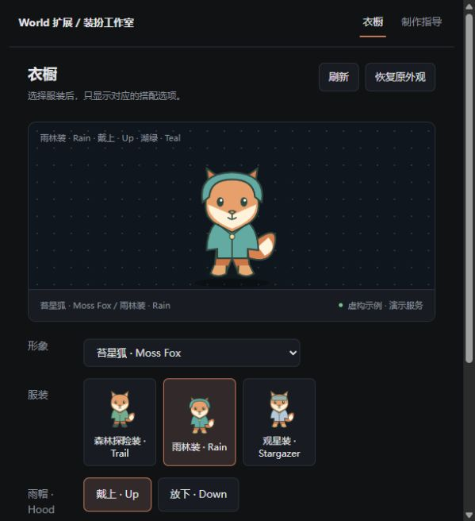

<div align="center">


# Wardrobe Studio

**Choose an outfit. Configure what belongs to it.**

Outfit-specific controls and a continuous-animation authoring guide for Coopanion.

[](https://www.npmjs.com/package/cortico-world-wardrobe-studio)
[](https://github.com/FelixHenrikChristian/cortico-world-wardrobe-studio/actions/workflows/check.yml)
[](LICENSE)

**English** · [简体中文](README_zh.md)

[Get started](#get-started) · [Create a character](docs/agent-workflow.md) · [Profile format](docs/profile-format.md) · [Downloads](https://github.com/FelixHenrikChristian/cortico-world-wardrobe-studio/releases)

</div>

---

## One outfit, its own controls

A character's outfits do not need to share every option. Wardrobe Studio groups existing complete figure schemes and displays only the controls that belong to the selected outfit.

| You want to… | Wardrobe Studio provides… |
| :--- | :--- |
| Organize a wardrobe | Outfit-specific options; unavailable combinations disabled |
| Choose a combination | Standard appearance persistence and local thumbnails |
| Use the native wardrobe | Optional, reversible compatibility adapter in 0.4 |
| Create a character | Reference prompts, continuous video, playback gates and temporal matting guidance |
| Write an import profile | Field tables, fictional examples, JSON Schema and installed-ID checks |

> [!IMPORTANT]
> Native integration is an **experimental opt-in compatibility patch**, not an official World slot. It temporarily patches the checksum-verified desktop-pet page and restores it on normal stop. Unsupported versions are refused. [Supported host, setup and recovery →](docs/native-integration.md)

<details>
<summary><strong>Separate-panel preview · entirely fictional artwork</strong></summary>
<br>
<div align="center"></div>

Moss Fox has cape/footwear options for trail outfits, hood/colour for rain outfits, and a visor for stargazer outfits. This screenshot illustrates the separate panel, not native compatibility mode.

</details>

## Get started

### 1 · Install and enable

Find **Wardrobe Studio** / `cortico-world-wardrobe-studio` in Coopanion's World extension market. Restart Core when requested and enable it. Alternatively, download a [GitHub release](https://github.com/FelixHenrikChristian/cortico-world-wardrobe-studio/releases), extract it and select the folder containing `package.json` in the manual installer.

### 2 · Prepare figure resources

Keep the desktop-pet World running and install/verify your figure pack first. The default service is `http://127.0.0.1:7797`; change it in the extension configuration if necessary, then restart this World.

**A wardrobe JSON groups existing resources; it contains no images or videos.** Every mapped combination must already be playable.

### 3 · Check and import

Open **Wardrobe Studio → Wardrobe → Import profile**. Inspect installed IDs, download the fictional example or JSON Schema, fill in your figure/schemes, run **Check configuration**, then import. Choose an outfit/options and **Apply**.

The extension UI defaults to Chinese. Its **中文 / English** selector is persistent and independent of the host language; imported names remain your own text.

[Complete profile format and example →](docs/profile-format.md)

### 4 · Optional native integration

Configure the installed desktop-pet `web` directory, enable **Native wardrobe compatibility patch**, and restart this World. Reopen the native wardrobe page. Configured figures show outfit/part rows; Coo and unconfigured figures retain their controls.

This mode is off by default. Read the [compatibility and rollback guide](docs/native-integration.md) before enabling it.

### 5 · Disable or uninstall

For changes made in the separate panel, use **Restore previous appearance** first. Disable the World and verify any native patch was restored before uninstalling. Native-page selections are ordinary host selections and remain valid after removal.

[Lifecycle and recovery →](docs/lifecycle.md)

## Create your own character

The guide panel, agent tool and downloadable manuals share the same source documents.

| Stage | Deliverable and acceptance |
| :--- | :--- |
| ① Plan | Identity, wardrobe/action matrix and reversible environment record |
| ② Reference | Fully dressed reference for each supported combination |
| ③ Continuous video | Dressed reference plus motion guidance; validate one short action first |
| ④ Raw-video review | Complete normal-speed, half-speed and loop playback |
| ⑤ Temporal matting | Correct masks, propagate over time and review on contrasting backgrounds |
| ⑥ Figure package | Coordinates, movement, transitions and actual expression coverage |
| ⑦ Wardrobe profile | Map installed complete schemes, validate and import |

[Read the detailed workflow →](docs/agent-workflow.md)

## Documentation

| Document | What it covers |
| :--- | :--- |
| [Authoring workflow](docs/agent-workflow.md) | Inputs, outputs, prompts, video/alpha requirements and figure interface |
| [Profile format](docs/profile-format.md) | Required fields, limits, full example and missing combinations |
| [Native integration](docs/native-integration.md) | Opt-in setup, exact compatibility, file changes and recovery |
| [Troubleshooting](docs/troubleshooting.md) | Stale resource URLs, connections and runtime resources |
| [Verification](docs/verification.md) | Checks performed and compatibility boundaries |
| [Changelog](CHANGELOG.md) | Version history |

## Data and compatibility

- Profiles, language and recovery records stay in this extension's local namespace. No conversation reading or internet requests.
- Figure manifests and animation assets are never modified. The optional native adapter temporarily changes only its documented page files.
- Native integration requires the exact reviewed desktop-pet page. Host updates can disable it; the independent panel remains available.
- World API 6, figure manifest/API 2, Node.js ≥22; no runtime npm dependencies or model downloads.
- Guidance provides instructions, not automatic media generation or missing animation resources.

<details>
<summary><strong>Development and agent tools</strong></summary>

```sh
npm run check
npm test
npm run preview
```

The preview uses isolated temporary data and fictional artwork. Tests exercise recovery and origin restrictions against disposable fixtures.

| Tool | Purpose |
| :--- | :--- |
| `wardrobe_list` | Inspect local profiles and current appearance |
| `wardrobe_choose` | Apply an existing valid combination |
| `wardrobe_restore` | Restore a separately leased appearance |
| `wardrobe_authoring_guide` | Read workflow, format and troubleshooting guidance |

Public examples are entirely fictional. Keep personal figures, profiles and production records outside this repository.

</details>

---

<div align="center">

[MIT License](LICENSE) · Independent extension · Not an official Coopanion / Pal AI Lab component

</div>
