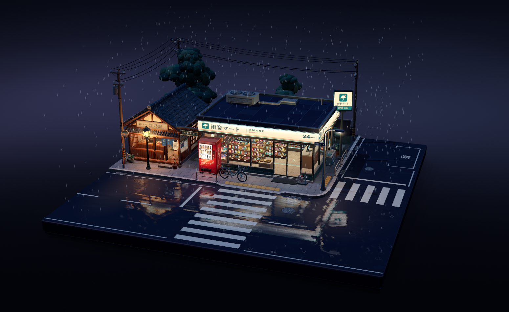

# 雨音マート · 灯影横丁



细雨中，雨音マート的青绿色招牌和茶房「灯乃庭」的琥珀色街灯映在路上。两家店之间是「灯影横丁」，沿巷口的町内掲示板往里看，可以看见通往后院的石板路。

打开模型，街面、货架、木梁、瓦片和架空电线会分层组装。拉近便利店橱窗可以看清饮料和杂志，转向茶房的木格窗能看见铁壶、茶杯和和菓子。

从雨音マート经过斑马线就是雨庭公寓。玄关接着客厅和餐厨，走廊通往卧室、书房和浴室，阳台旁有八块可独立选取的菜畦。街口的唱片店、洗衣房和沿街公寓使用原创模型与店招。

右下角按钮循环切换完整外观、自动剖墙和无墙视图。自动剖墙会跟随镜头隐藏挡住房间的墙段。家具与菜畦提供稳定标识、点击事件和角色接近位置。[桌宠接入说明](docs/desk-pet.md)

## 打开模型

在仓库中点开 [amane-mart.html](amane-mart.html)，点击文件右上方的下载按钮（Download raw file）。用浏览器打开下载的 HTML，即可离线观看。刷新页面可重播组装动画。

| 设备 | 操作 |
| --- | --- |
| 鼠标 | 左键拖拽旋转，滚轮缩放，右键拖拽平移。 |
| 触屏 | 单指拖拽旋转，双指捏合缩放，双指同向拖动平移。 |
| 键盘 | 先点一下画面，使用方向键旋转、加减键缩放，按 Home 返回初始视角。 |

## 从源码构建

场景源码位于 [src/](src/)。在仓库根目录依次运行以下命令，即可重新生成 `amane-mart.html`。

```sh
npm ci
npm run build
```
