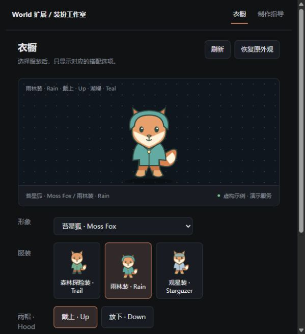

# 装扮工作室 · World 扩展

在独立衣橱面板中，先选择服装，再显示这套服装自己的搭配选项。通过本地配置把选项组合映射到形象包已有的完整装扮，不修改 Coopanion 原生装扮页或角色文件。



例如，虚构角色“苔星狐”的森林探险装有斗篷、足部装备；雨林装有雨帽、雨披颜色；观星装有护目镜。切换服装后，配置项随之改变。没有资源的组合不能应用。界面跟随宿主配色，采用点阵预览区、紧凑服装卡片和横排选项；本机预览读取形象包缩略图，公开示例只使用虚构角色。

## 使用

1. 在 World 扩展的手动安装中选择本包目录；按宿主提示重启进程，再启用“装扮工作室”。首次接入请先用隔离数据验证。
2. 保持桌宠 World 可用。默认地址为 `http://127.0.0.1:7797`；端口不同可在扩展配置中修改，之后重启此 World。
3. 打开扩展的“衣橱”面板，导入属于本机角色的 JSON 分组配置，选择服装和搭配，点击“应用装扮”。[配置格式](docs/profile-format.md)包含完整虚构示例。
4. 卸载前点击“恢复原外观”，确认成功后停用并卸载扩展。正常停用也会尝试恢复；在原生页另做的选择会被保留。[生命周期和异常恢复](docs/lifecycle.md)说明边界。

本扩展不会把已有图片拼成未制作的服装，也不会自动补齐动作。先为每个有效搭配制作并验收完整资源，再配置其映射。Coo 自带配件使用独立契约，继续由原生页管理。

## 角色制作指导

“角色制作指导”面板和 agent 工具提供分阶段工作流：角色与完整穿衣参考定稿、连续动作视频、原速／半速及循环验收、本地连续抠像、姿态与表情支持范围、运行时接入和版本发布。[完整指南](docs/agent-workflow.md)只包含可复用的制作流程，没有个人角色或历史素材。

工具：`wardrobe_list`、`wardrobe_choose`、`wardrobe_restore`、`wardrobe_authoring_guide`。指导工具只返回说明，不安装工具、下载模型、执行生成任务或读取聊天记录。

## 数据与兼容

扩展只在自己的 `wardrobe-studio/` 目录保存本机衣橱和外观恢复记录。选择已有搭配通过桌宠标准外观接口生效，其他偏好保持原值。形象包、主程序、其他扩展和素材不被改写。

正常停用时会恢复仍由本扩展接管的外观。强制结束进程、桌宠服务提前停止或旧形象被删除时，恢复可能需要下次启用后执行；不能承诺这些情形下无条件自动恢复。扩展通过现有有效装扮切换，卸载不会让原形象依赖缺失的扩展代码。

当前为实验性首版：World API 6、形象包 manifest/API 2、Node.js ≥22，零运行时 npm 依赖。已在真实 Core 宿主中验收配置切换、应用外观、停用恢复和重新启用。独立面板不改变原生装扮页的固定配置轴。[验证范围](docs/verification.md)与[发布方式](docs/publishing.md)说明当前边界和市场流程。

## 开发预览

```sh
npm test
npm run check
npm run preview
```

预览使用独立临时数据和虚构角色，不连接已有 Coopanion。正式包没有图片、视频模型或私有角色素材，只有虚构示例和工具代码。

MIT License。第三方独立扩展，不代表 Coopanion 或 Pal AI Lab 官方。
