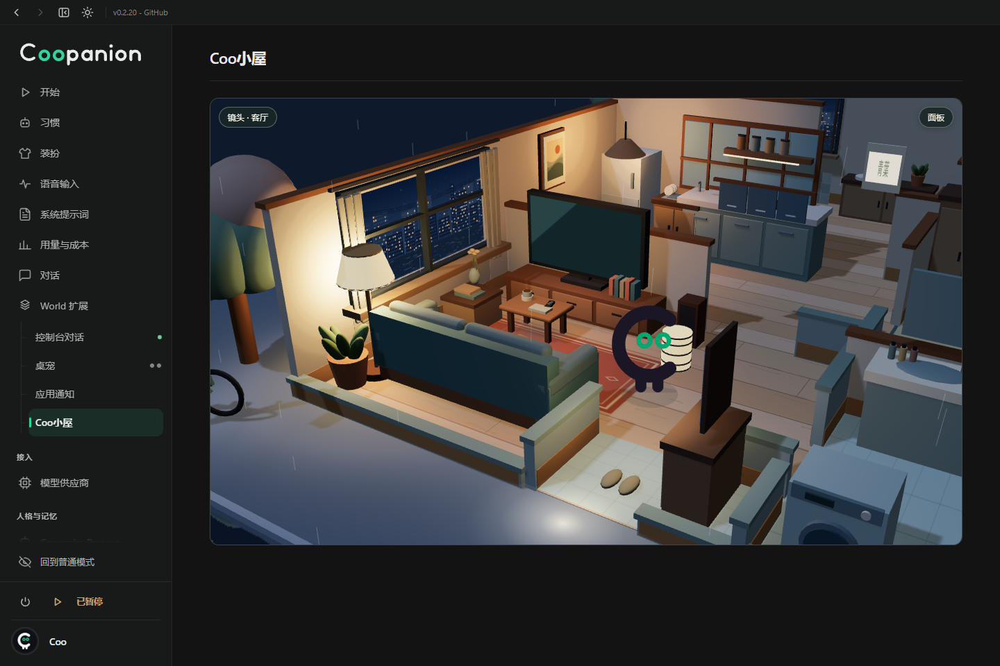

# Coo小屋

在 Coopanion 的一个 World 扩展页面里，和当前装扮的 Coo 一起生活。默认进入客厅。点家具查看怎样使用，点地面让 Coo 走过去，也可以直接把 Coo 拖到家具旁。住宅与独立便利店分居十字路口的两个街角。Coo 从玄关走出，沿斑马线过街，经过滑门进入店内购物。

[十字路口实景](assets/crossing.png) · [便利店内景](assets/shop.png)

## 安装

从 [Coo小屋 GitHub Release](https://github.com/FelixHenrikChristian/coopanion-plugins/releases/tag/coo-home-v0.3.0) 下载 `CooHome-0.3.0.zip`，解压到长期保留的目录。在 Coopanion 的 World 扩展管理中选择从本机目录安装，选解压后含 `package.json` 的 `coo-home` 文件夹。也可以选择源码仓库里的 `packages/cortico-world-coo-home`。按宿主提示重启，在 World 总览启用「Coo小屋」，从左侧打开。

运行时使用 Coopanion World API 6，已在 0.2.20 的隔离部署中验证。请同时启用桌宠 World，以便房间读取当时的形象和配色。包中带有构建好的浏览器面板。

## 在家里

| 空间 | 设施和生活内容 |
| --- | --- |
| 客厅 | 布艺沙发、茶几、电视、落地灯、窗景和音箱。坐下休息，选节目，或把本地视频放到电视上。|
| 厨房、餐厅 | 冰箱、灶台、水槽、锅具、餐桌、茶柜和餐边柜。做一份饭，再坐下来吃；有收获的蔬菜时做饭会消耗一份。|
| 卧室、书房 | 床、衣柜、床头柜、台灯、书架、书桌和电脑。睡觉恢复精神，读书或写字会留下记录。|
| 玄关、洗面洗衣室、浴室 | 鞋柜、雨伞、洗手台、滚筒洗衣机、浴缸与便器。可以换鞋、洗漱、泡澡和洗衣。|
| 阳台、菜园 | 把洗好的衣服拿来晾；四畦地可种萝卜、豌豆或番茄。播种后浇一次水，分别约 90、125、180 秒成熟。|
| 街口、便利店 | 人行道、路灯、斑马线、车架、贩卖机和可进入的便利店。散步、买便当、买饮料、买种子和卖菜。小屋内的零钱只用于这些虚拟交易。|

## 场景里的面板

左键拖动环绕，右键拖动平移，滚轮缩放。聚焦场景后按 H 可隐藏或恢复浮层，Esc 也能恢复。镜头预设可用于定位，平移后停在自由观察的位置。初次观察街区时，便利店按地台、墙面、陈列与屋顶分层组装；系统开启减少动态效果时直接显示完成状态。靠近店内观察时屋顶让开。

平时只显示场景、镜头入口和面板入口。点 Coo 打开角色面板，点家具打开对应的物件卡，拖放则直接执行。按 Esc 或 × 收起面板。「房间里的物件」提供键盘也能使用的点选方式。

| 面板 | 条目 |
| --- | --- |
| 镜头 | 房间、全屋俯瞰、跟随 Coo、放大、缩小、复位。|
| Coo | 位置、当前活动、精神、饱腹、当前装扮报告支持的动作、聊天和跟随。|
| 刚刚发生 | 最近 32 条生活记录，标明时间和发起者。|
| 电视 | 三个自制动态频道、开关、一起看、本地视频、原声开关和结束播放。视频只在本页解码，关闭页面即释放。|
| 菜园 | 种植页查看四畦地、选种、浇水与采收；仓库显示收成、种子与零钱；种子铺安排 Coo 去隔壁购买。|
| 便利店 | 便当 70、饮料 20、三包种子 30、出售一份蔬菜得 55。到店并完成动作才结算。|
| 和 Coo 聊聊 | 消息通过宿主事件送到当前 Coo；它可用小屋工具回话。保留最近 30 条。模型服务与主循环须可用才能收到模型回复。|
| 环境与操作 | 光照、街区降雨、自主生活、操作说明和装扮连接状态。|

## Coo 怎样自主生活

World 启用时运行日程，按饱腹、精神、菜地长势和时段选择活动。步行经过门洞并避开家具。离开页面后，World 继续运行；关掉 Coopanion 后，重新启动会结算到期活动与作物。手动安排优先，可以打断 Coo 的计划。中途改主意不会提前扣零钱或发放物品。

Coo 能使用 `coo_home_look`、`coo_home_visit`、`coo_home_tv` 和 `coo_home_say`。例如在聊天里说「做一份饭，做好叫我」。自主作息本身不需要模型调用。房间进度与聊天记录保存在本部署的 `worlds.coo-home.life`，与当前形象包独立。

## 房间模板与开发

`src/layout.js` 是地图、墙体、门洞、家具站位和步行障碍的共同来源。坐标按米计，X/Z 是地面。`models.js`、`interior.js`、`household.js` 和 `city.js` 绘制房间与街道。`life.js` 负责路径时间、活动与库存规则。扩建时请一并检查人物停靠点和家具占地。

需要 Node.js 22.10+ 和 npm。在包目录执行 `npm install --ignore-scripts`、`npm run build`、`npm run describe`、`npm run check`、`npm test`、`npm run pack:check`。浏览器包内含 Three.js，店内陈列和商品均为几何模型；使用时无需 CDN、额外服务或新窗口。

[动画对照与待制作清单](ANIMATIONS.md) · [资源与许可](THIRD_PARTY.md)
