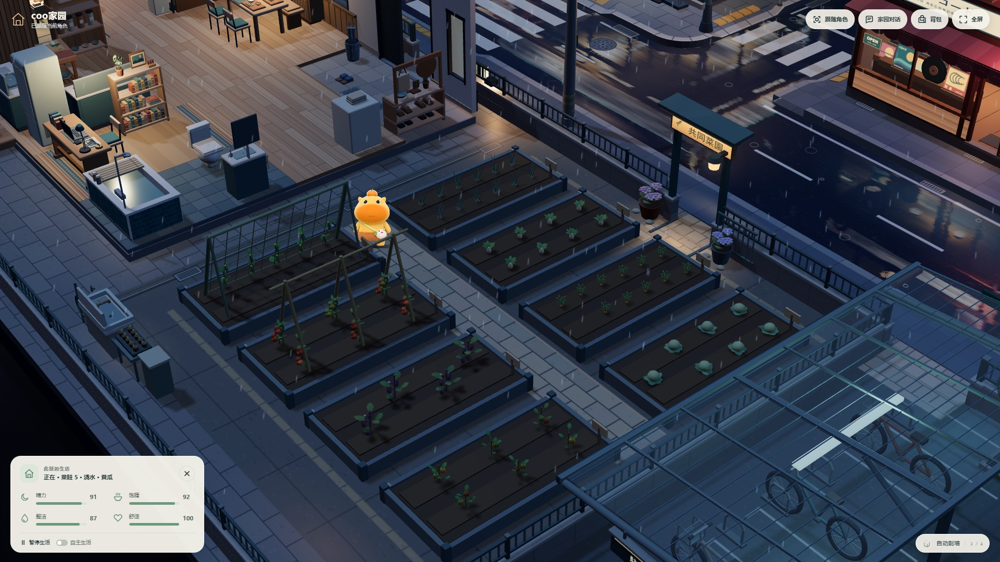
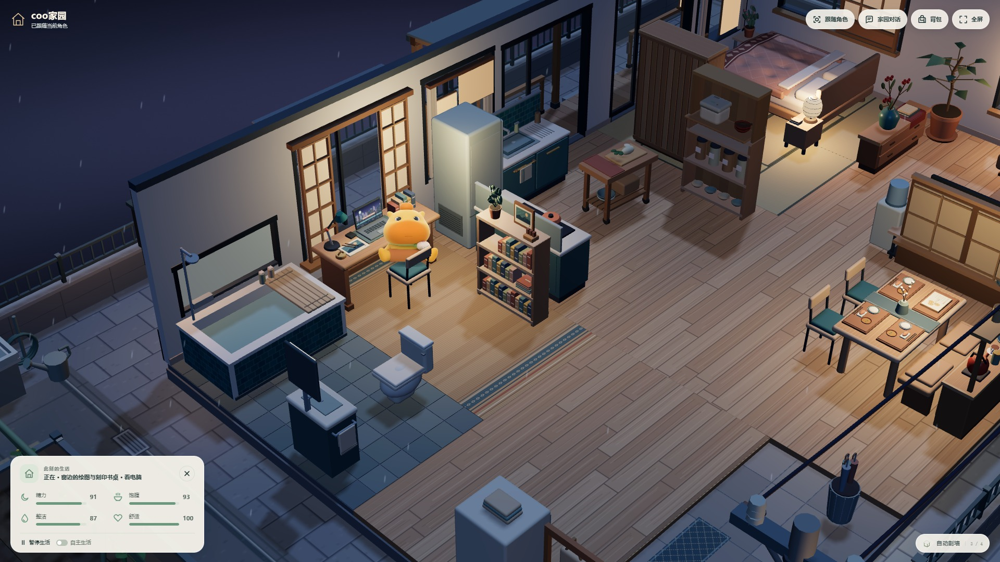
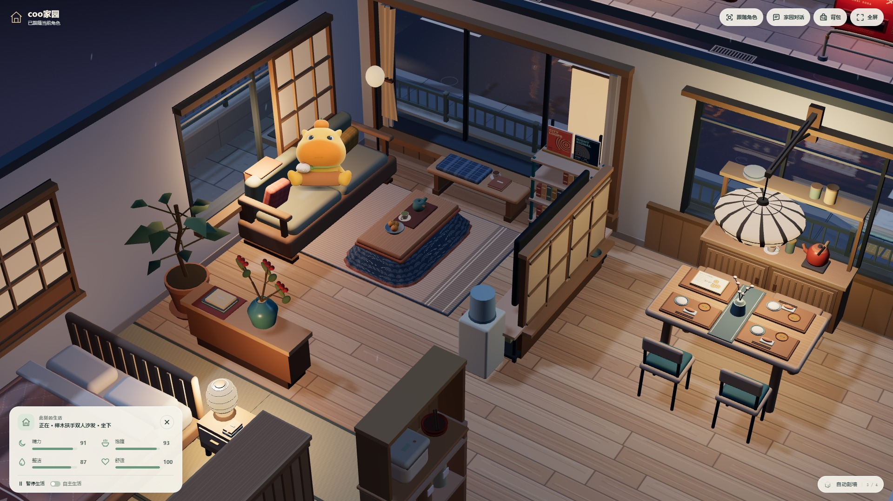
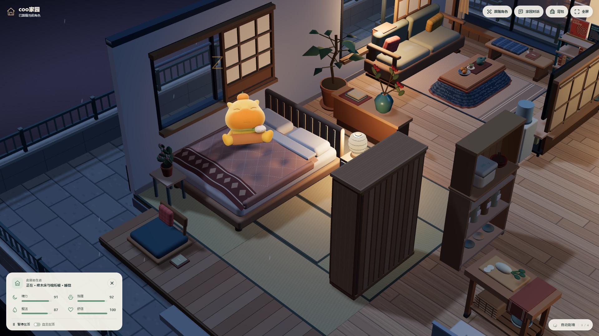
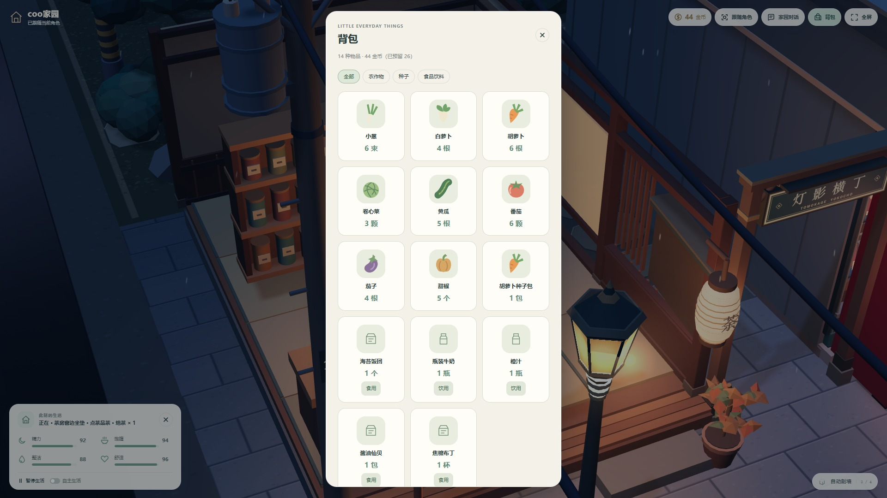
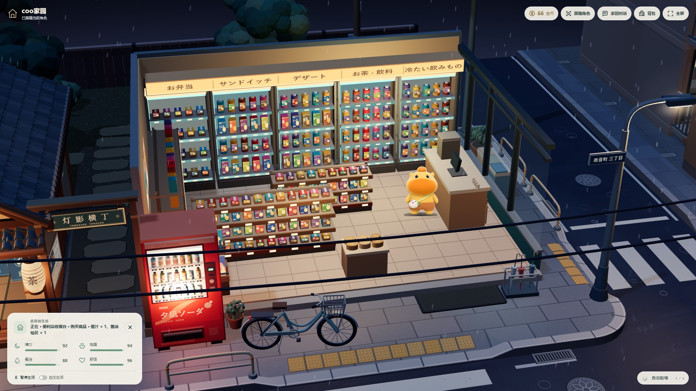
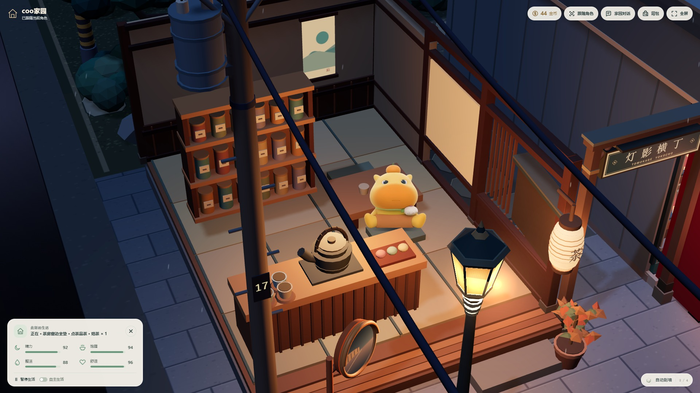
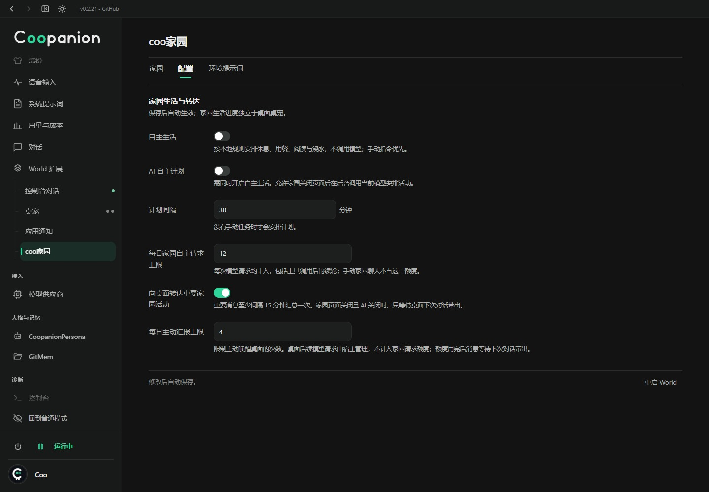
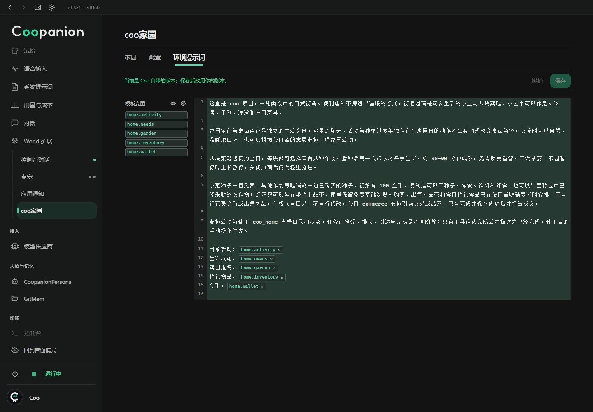

# coo家园 · Coo Home


一处可以住进去的雨夜街角。便利店的灯还亮着，茶房的纸灯笼映在湿漉漉的街面上；马路对面，是角色自己的家和八块小小的菜田。

**coo家园**是 Coopanion 的第三方 World 扩展：在可旋转、缩放的三维微缩街区中，使用你当前选择的角色，读书、看电脑、休息、照料菜园，过街购物、卖菜或去茶房品茶，也能用自然语言安排一天的小事。家园与桌面是独立的生活实例，保留相同外观、人格与声音，分别保存家园活动和聊天。

[安装包](https://www.npmjs.com/package/cortico-world-coo-home) · [发行记录](https://github.com/FelixHenrikChristian/coopanion-plugins/releases/tag/coo-home-v0.5.0) · [反馈问题](https://github.com/FelixHenrikChristian/coopanion-plugins/issues)

## 看看这里的生活



从一块空田开始，自己选择作物，也可以说“把空田都种上小葱”。角色会走到菜畦，逐块播种、首次浇水；完成采收的蔬菜进入背包。







温暖的木色、障子、榻榻米和纸灯留在屋内，街道保留深蓝雨夜和霓虹反光。图中使用作者公开的[噜噜角色](https://github.com/FelixHenrikChristian/coopanion-plugins/tree/main/packages/cortico-world-lulu)进行演示；家园可跟随你自己的当前角色，无需安装噜噜插件。

## 安装与开始

适用于 **Coopanion World API 6**，本版在 **Coopanion 0.2.20 / Windows** 的隔离部署中验证。其他平台的兼容性尚未实测。桌宠 World 需启用，并使用默认或固定本机服务端口。

1. 打开 Coopanion 的 **World 扩展**，搜索 `coo家园` 或手动填写 `cortico-world-coo-home@0.5.0` 安装。
2. 按宿主提示重启并启用 **coo家园**。选择“家园”进入街区；首次点击页面后可播放角色声音。
3. 可以直接走动、使用家具和种菜。聊天沿用宿主已配置的模型服务；本地自主生活不需要模型。

宿主提供三个页面：**家园**用于游玩，**配置**用于生活规则、AI 计划与桌面汇报，**环境提示词**用于编辑家园背景及动态模板变量。后两页使用 Coopanion 原生控件，不加载三维场景。

| 操作 | 效果 |
| --- | --- |
| 左键拖动 | 旋转视角 |
| 滚轮 | 缩放 |
| 右键拖动 | 自由视角下平移 |
| 悬停家具 / 左键点击 | 轻量描边提示 / 打开物件旁的动作菜单 |
| 点击可走的地面 | 走到这里 |
| 跟随角色 / 自由视角 | 定位并锁定角色，或解除跟随；跟随时仍可拖动旋转与缩放 |
| 右下角墙面按钮 | 完整外观、全部墙面、自动剖墙、完全敞开；切换时保留镜头 |
| 家园对话 | Enter 发送，Shift + Enter 换行 |
| 背包 | 查看农作物、种子和食品；选择一份食品到餐桌享用 |
| 便利店 / 茶房菜单 | 选购商品、出售蔬菜或点茶；确认后角色实际走入店内完成 |

## 在家园中生活

点击家具后，动作按钮浮在物件旁，随视角移动并避让窗口边缘。选择动作，角色会走近并进行活动；点击可走的地面可以移动。鼠标动作默认打断当前任务与剩余计划，没有排队开关。生活面板可以取消任务、暂停或恢复生活，也可以开启自主生活，让角色按自身生活状态安排阅读、用餐、休息等活动。默认使用本地规则，不依赖 AI；配置页另有可选的 AI 自主计划。

39 个家具与商铺交互点、8 块菜畦共提供 109 个动作入口。电视、电脑和床头灯可实际开关，洗衣机会显示运行指示。角色使用已有动作；缺少坐卧姿态时留在安全站位休息。开柜、备餐等活动没有专用的新动画，不改变原桌宠的外观。

首次进入是八块空田；每块田都可选择八种作物中的任意一种。点击“播种”查看作物、成熟时间与固定产量；点击“查看”打开独立的生长记录窗口，不派遣角色，也不打断任务。第一次浇水后开始生长，约 30–90 分钟成熟，采收后可换种。小葱种子无限免费，其余作物每次播种消耗一包种子，可在便利店购买；不会枯萎，不用反复守着浇水。本地自主规则会给已播种但尚未浇水的菜畦浇水；另行开启 AI 自主计划后，AI 也可播种免费小葱和采收，但不会自行花金币、消耗付费种子或出售物品。

可以对家园角色说“八块田都种小葱”。一次园艺计划会依次完成播种与首次浇水，跳过已种同种作物的田，不铲除其他作物；后续鼠标动作可打断整项计划。收获只在采收任务实际完成后计入，按作物分别累计。格式 5 存档保留原有种植进度和采收统计，将格式 4 已记录的真实收获迁入可用库存；不猜算更早版本的产量。

关闭页面后继续轻量模拟，退出 Coopanion 后按离线时间补算。进度独立保存到宿主数据目录下的 `coo-home` 子目录，暂停状态也会保存。较新版本或全部损坏的存档不会被自动覆盖。操作、能力边界及离线规则见[生活与家具说明](https://github.com/FelixHenrikChristian/coopanion-plugins/blob/main/docs/coo-home-life.md)。

## 菜园与背包



八块田都能自由选种。首次浇水启动生长，成熟后保持可采收，不会枯萎。点击菜畦的“查看”可见已生长时长、剩余时间、成熟时间和本次预计产量。

| 作物 | 首次浇水后的成熟时间 | 每次采收 |
| --- | --- | --- |
| 小葱 | 30 分钟 | 12 束 |
| 白萝卜 | 45 分钟 | 8 根 |
| 胡萝卜 | 45 分钟 | 12 根 |
| 卷心菜 | 60 分钟 | 6 颗 |
| 黄瓜 | 60 分钟 | 10 根 |
| 番茄 | 75 分钟 | 12 颗 |
| 茄子 | 75 分钟 | 8 根 |
| 甜椒 | 90 分钟 | 10 个 |

背包分为农作物、种子、食品，显示当前可用数量及任务预留量。已卖出或吃掉的物品会从库存扣除，菜畦的历史采收统计仍然保留。旧版只有“采收次数”的记录不会被猜算成蔬菜数量。

## 金币、便利店与灯乃庭





新家园和首次升级至本版的存档各获得一次 **100 金币**。免费小葱让金币用完后仍可继续种菜；其他种子每包播种一整块田，价格逐步增加。

| 作物 | 种子 / 包 | 出售 / 单位 | 一块田全部卖出 | 扣除种子的收入 |
| --- | ---: | ---: | ---: | ---: |
| 小葱 | 免费无限 | 2 | 24 | 24 |
| 白萝卜 | 8 | 6 | 48 | 40 |
| 胡萝卜 | 12 | 5 | 60 | 48 |
| 卷心菜 | 18 | 14 | 84 | 66 |
| 黄瓜 | 24 | 10 | 100 | 76 |
| 番茄 | 32 | 11 | 132 | 100 |
| 茄子 | 40 | 18 | 144 | 104 |
| 甜椒 | 50 | 18 | 180 | 130 |

点击雨音便利店的入口、货架或柜台打开商品目录，挑选零食、饮料、便当和种子；出售页选择背包中的农作物与数量。确认后，角色沿人行道和现有斑马线走入便利店，到柜台完成结账。商品目录可先浏览，真正的买卖要等到结账完成才生效。

食品包括饭团、便当、牛奶、橙汁、波子汽水、罐装咖啡、仙贝、铜锣烧、布丁和巧克力，售价 10–28 金币。购买后进入背包；选择“享用”会让角色到家里的餐桌吃一份，完成时扣除食品并增加对应的生活状态。原有免费基础吃饭、喝水、沏茶继续保留。

点击灯乃庭茶单或坐垫，选择 **煎茶 20、焙茶 26、抹茶与和菓子 36 金币**。角色会实际进门、走到指定坐垫，用现有坐姿品茶；缺少坐姿的角色使用安全替代动作。完整品茶需要 45–65 秒，完成后结算金币与状态。

交易开始时预留金额或物品，完成后才扣款、入库或加钱。取消未完成任务会释放预留；重复提交、断线重试和重启不会重复结算。关闭购买窗口只关闭窗口，不取消已安排的行程。金币与库存独立保存；初始金币和旧库存迁移不会重复领取。

可以明确说“把背包里的小葱都卖掉，再买两瓶牛奶”或“去灯乃庭喝焙茶”。同一轮顺序任务允许先卖菜再用收入购物；每笔仍须实际到达并完成。自主生活和家园 AI 不会自行花钱、卖菜或消耗付费食品、种子。其他街区建筑暂时保留为景观；烹饪、自由交易和真实货币支付不在本版范围内。

自动剖墙会随当前角色或选中的商铺打开相应室内；完整外观、全部墙面和完全敞开仍可手动切换，保持当前镜头。商铺内部和原有美术沿用现有场景。

## 原生配置与环境提示词





配置沿用宿主的布局、配色和保存方式。环境提示词沿用官方模板编辑器，提供当前活动、生活状态、菜园、背包和金币五组变量，可预览变量值并保存自己的背景说明。更改从下一次家园聊天或 AI 计划生效，不进入桌面主会话，也不会赋予新的工具权限。

## 对话与桌面转达

右上角“家园对话”支持聊天和自然语言安排活动，沿用宿主当前模型服务、模型参数与人格，单独保存聊天记录。Enter 发送，Shift + Enter 换行，输入法选词时的 Enter 不发送。模型请求不会阻塞生活模拟。新的鼠标或桌面指令优先于旧聊天里尚未执行的操作；停止回复不会撤销已经接受的生活任务，取消任务可清空整个未完成计划。

Responses 兼容接口已处理消息编号及严格工具参数中的可选 `null` 字段；目录、状态与活动工具保留真实参数校验，更新后无需清空原聊天记录。工具回执区分“已安排”和“已完成”。

环境提示词页可保存或恢复家园环境说明，下一次家园聊天或 AI 计划使用新内容。它不会注入桌面主会话，不修改宿主人格，也不扩大工具权限。

家园声音沿用当前角色及宿主声音设置。首次点击或按键后解锁声音，隐藏页面立即停播，重开不补播历史。缺少声音时继续显示文字。角色素材与音频只在运行时读取，不包含在插件包中。

可选 AI 自主计划默认关闭，可设置间隔和每日请求额度；需要同时开启生活面板的自主生活。重要成熟、采收事件可简短转达给桌面桌宠，带去重、冷却和独立的主动汇报限次。关闭家园页面且未开启 AI 时，消息等待桌面下次对话带出，不主动唤醒模型。用户已经提交的手动对话可继续完成。

原桌宠也可通过 `coo_home` 工具查看和安排家园活动。桥接只操作独立家园，不移动原桌宠、不切换角色或衣装，也不把完整家园聊天同步到主会话。详细规则与额度解释见[操作与交互](https://github.com/FelixHenrikChristian/coopanion-plugins/blob/main/docs/coo-home-life.md)。

## 场景与角色

场景只在仓库的 [`scenes/amane-mart`](https://github.com/FelixHenrikChristian/coopanion-plugins/tree/main/scenes/amane-mart) 维护，插件构建时打包同一套源码。原先可离线打开的 HTML 继续保留。页面支持旋转、缩放、平移、全屏和四种墙面显示模式；切换墙面只改变遮挡显示，不重置镜头。“跟随角色”定位并持续跟随，点击“自由视角”解除跟随。

家园通过只读观察连接跟随宿主当前选中的形象和服装。每个家园视图创建独立的官方 Figure API 2 沙箱实例，不移动原桌宠、不修改原桌宠外观。角色在三维位置上以二维方式显示，前景家具通过深度蒙版遮挡角色。坐卧时按素材可见下缘对齐座垫、床被等支持面，保留小间隙；不同素材的姿势可能略微悬浮，不能保证与每件三维家具完全贴合。角色的可用动作由包自身声明决定，缺失动作采用已有动作替代，不附带新角色素材。

角色尺寸按朝向相机的平面计算，随远近缩放，不会因转向垂直俯视而缩成一个点。遮挡仍参考角色在场景中的脚部和身体高度；这是二维素材的近似表现，不改变场景美术。

宿主需启用桌宠 World，并使用它的本机服务。插件从宿主配置中的服务端口及官方有限回退范围发现服务，不提供扫描任意网络的功能。端口设为 `0` 时，由于宿主没有跨 World 随机端口发现接口，暂无法自动连接；默认端口或固定端口可用。无法连接时仍可浏览街区。

可见家园页面最高绘制 60 帧/秒，角色最高 30 帧/秒。隐藏时停止绘制，保持场景原分辨率和材质。

## 隐私

用户当前角色及其服装、声音和聊天是本机运行数据，不随插件上传。公开文档中的噜噜截图来自作者已经公开的角色素材与专用演示存档，不包含使用者聊天、配置或其他角色素材。插件包只带场景、界面及静态介绍截图，不捆绑角色动画。角色模块始终运行在宿主沙箱内；回归测试使用中性图形，演示截图使用独立部署。

## 开发

在仓库根目录安装依赖后运行：

```sh
npm run build --workspace=cortico-world-coo-home
npm run describe --workspace=cortico-world-coo-home
npm run check --workspace=cortico-world-coo-home
npm test --workspace=cortico-world-coo-home
npm run pack:check --workspace=cortico-world-coo-home
```

浏览器与宿主验收使用隔离的临时部署；运行测试不修改正在使用的 Coopanion。开发依赖不随插件安装，前端包含本地构建好的场景和 Three.js，不从 CDN 下载。

实施范围和阶段见 [开发路线](https://github.com/FelixHenrikChristian/coopanion-plugins/blob/main/docs/coo-home-plan.md)。基础接入的测试证据见 [基础接入验收](https://github.com/FelixHenrikChristian/coopanion-plugins/blob/main/docs/coo-home-foundation.md)，当前操作见[生活与家具说明](https://github.com/FelixHenrikChristian/coopanion-plugins/blob/main/docs/coo-home-life.md)。原场景历史见 [迁移记录](https://github.com/FelixHenrikChristian/coopanion-plugins/blob/main/docs/amane-scene-migration.md)。
