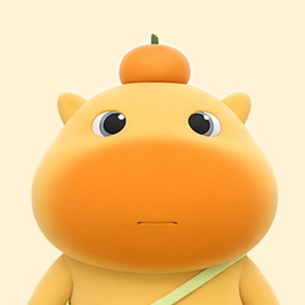
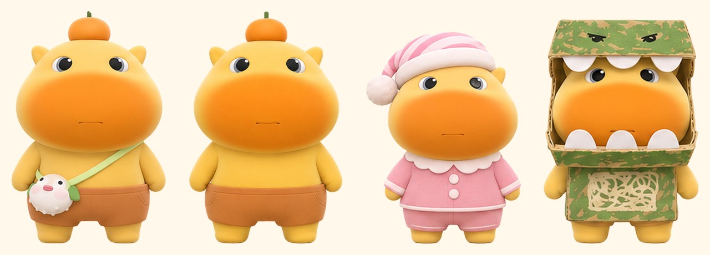
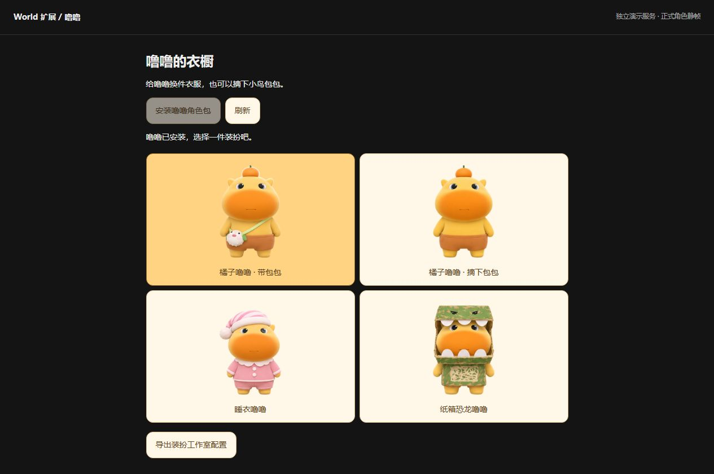

# 噜噜 / Lulu

独立的 Coopanion World API 6 插件：安装水豚噜噜，打开衣橱看图选装扮，也可以摘下小鸟包包。图标与下方照片直接取自正式角色包，保留原始比例。

从左到右：**橘子装带包、橘子装摘包、粉色睡衣、纸箱恐龙**。三套服装、四个完整外观。照片为静态预览，角色包另含连续动作，以及站立和坐定时各 19 种表情。小鸟包包通过带包和摘包两套完整动作切换，行走或转身时跟随对应身体。

## 安装与使用

1. 在 Coopanion 的 World 扩展手动安装器填写 **`cortico-world-lulu@0.1.4`**，按宿主提示重启 Core 并启用。也可下载 [GitHub 插件安装包](https://github.com/FelixHenrikChristian/coopanion-plugins/releases/tag/lulu-v0.1.4)，解压后选择含 `package.json` 的目录。
2. 保持桌宠 World 运行，打开 **噜噜 → 噜噜的衣橱**，点击 **安装噜噜角色包**。这一步下载约 147 MB 的角色资源并校验固定 SHA-256；需要网络。
3. 点击对应照片切换外观。已安装角色时不会自动覆盖；从旧版角色包升级，请将 [0.1.2 角色 ZIP](https://github.com/FelixHenrikChristian/coopanion-plugins/releases/tag/lulu-v0.1.2) 导入桌宠原生装扮页，选择替换 `lulu-capybara`。

截图使用独立预览服务与正式角色静帧，不含个人配置。面板照片随插件提供，尚未下载角色包时也能查看；换装需先安装完整资源。

## 接入装扮工作室

点击 **导出装扮工作室配置**，再到 **装扮工作室 → 衣橱 → 导入衣橱配置** 中校验并导入 JSON。橘子装会显示“小鸟包包：戴上／摘下”，睡衣和恐龙装各自对应已有完整外观。两个插件可分别安装，没有运行依赖；JSON 仅包含服装分组和 ID 映射，不携带角色媒体。

## 更新、停用与排查

- **0.1.4** 更新真实素材头像、四张外观卡片及图文说明。完整角色包仍为 **0.1.2**，无需因本次图标更新重新下载动作资源。
- 0.1.3 修复衣橱被宿主布局压窄；0.1.2 修复思考时持续朝上看的眼神。详见 [更新记录](CHANGELOG.md)。
- 插件停用时结束安装任务，已安装角色及所选服装保留。删除角色请使用桌宠原生装扮页。
- 默认桌宠地址为 `http://127.0.0.1:7797`；地址不同可在配置中修改，之后重启插件。只支持本机 HTTP 地址。

## English

Lulu is an independent Coopanion World API 6 extension. Install `cortico-world-lulu@0.1.4`, enable it and open Lulu's wardrobe. Install the separate figure pack, then choose one of the four pictured looks. The orange outfit supports a removable bird bag; pajamas and cardboard dinosaur use their own complete animations. Export a profile to use the same wardrobe in Wardrobe Studio; neither extension depends on the other.

Version 0.1.4 replaces the illustrated icon with an aspect-preserving crop from the released figure and bundles outfit photos for the panel and documentation. The animated figure remains version 0.1.2. The figure download is approximately 147 MB and is pinned to a SHA-256 checksum. Existing figures are never silently overwritten; import the figure ZIP in the desktop pet's appearance page to replace an older copy.

## Development and rights

Run `npm run describe`, `npm run check`, `npm test` and `npm run pack:check`. Tests use isolated HTTP fixtures and do not modify a running Coopanion installation.

角色以用户提供的噜噜视频和确认的设定图为参考。MIT 许可证适用于插件代码；噜噜及其参考／预览图的权利归各自权利人。插件仅包含获准公开的头像、四张预览照片及界面截图；完整动画媒体仍作为单独资源提供。
