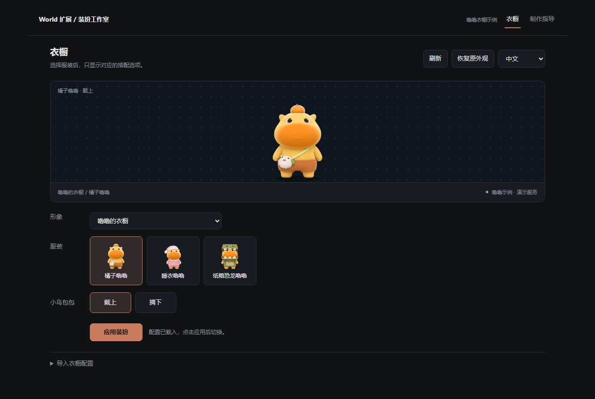
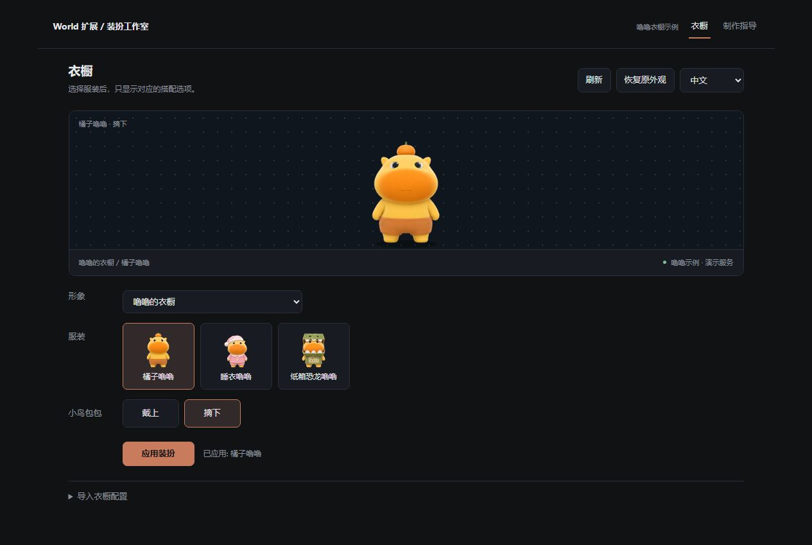

<div align="center">


# Wardrobe Studio

**An independent wardrobe for outfits and accessories.**

A separate wardrobe for Coopanion characters: choose an outfit, then switch the bag or other accessories it supports. Includes a complete character creation guide, from references and animated actions/expressions through matting and figure packaging.

The capybara in the example screenshots comes from the [Lulu plugin](https://www.npmjs.com/package/cortico-world-lulu). Each plugin works independently; combine them with Lulu's figure pack to try outfits and the removable bird bag here.

[](https://www.npmjs.com/package/cortico-world-wardrobe-studio)
[](https://github.com/FelixHenrikChristian/coopanion-plugins/actions/workflows/check.yml)
[](LICENSE)

**English** · [简体中文](README_zh.md)

[Get started](#get-started) · [Create a character](docs/agent-workflow.md) · [Profile format](docs/profile-format.md) · [Downloads](https://github.com/FelixHenrikChristian/coopanion-plugins/releases)

</div>

---

## A wardrobe for each character

Install a figure pack and import its wardrobe profile, then use one independent panel to select a character, change its outfit and switch the accessories supported by that outfit. For example, Lulu's orange outfit can wear or remove the bird bag, while Pajamas and Cardboard Dinosaur expose their own supported choices.

Every selectable combination uses a complete look already supplied by the figure pack. To create another character or add outfits/accessories, follow the extension's complete Authoring Guide for references, animated actions and expressions, matting and figure integration.

| You want to… | Wardrobe Studio provides… |
| :--- | :--- |
| Organize a wardrobe | Outfit-specific options; unavailable combinations disabled |
| Choose a combination | Local appearance selection, persistence and thumbnails |
| Create a character | Reference prompts, continuous video, playback gates and temporal matting guidance |
| Write an import profile | Field tables, Lulu examples, JSON Schema and installed-ID checks |

> [!IMPORTANT]
> **0.6.0 is independent-panel only.** Host-page patches have been removed. Stop the old version and verify rollback before upgrading; see the [migration guide](docs/panel-only-migration.md). [Maintainer review restored market listing](https://github.com/Pal-AI-Lab/cortico-extensions/issues/853#issuecomment-6832234773).

## Lulu wardrobe in pictures



Captured from the actual panel against an isolated demo service. The character comes from the [Lulu plugin](https://www.npmjs.com/package/cortico-world-lulu), using stills from its released figure pack without personal settings. Selecting Orange shows its bird-bag controls; Pajamas and Cardboard Dinosaur expose their own supported choices.



Orange with/without the bag maps to <code>bag</code>/<code>plain</code>; Pajamas and Dinosaur map to <code>sleep</code>/<code>dino</code>: **three outfits, four complete looks**. Press **Apply** to switch the pet. These are static previews; the [independent Lulu figure pack](https://github.com/FelixHenrikChristian/coopanion-plugins/releases/tag/lulu-v0.1.2) supplies the complete animations.


## Get started

### 1 · Install and enable

The package has been reinstated in the official index. Refresh the World market and search for **Wardrobe Studio** or **装扮工作室**. You can also install `cortico-world-wardrobe-studio@0.6.2` through the manual installer, or download a [GitHub release](https://github.com/FelixHenrikChristian/coopanion-plugins/releases), extract it and select the folder containing `package.json` in the manual installer.

### 2 · Prepare figure resources

Keep the desktop-pet World running and install/verify your figure pack first. The default service is `http://127.0.0.1:7797`; change it in the extension configuration if necessary, then restart this World.

**A wardrobe JSON groups existing resources; it contains no images or videos.** Every mapped combination must already be playable.

### 3 · Check and import

Open **Wardrobe Studio → Wardrobe → Import profile**. Inspect installed IDs, download the Lulu example or JSON Schema, fill in your figure/schemes, run **Check configuration**, then import. Choose an outfit/options and **Apply**.

The [default Lulu profile](examples/lulu.profile.json) matches the [independent Lulu figure release](https://github.com/FelixHenrikChristian/coopanion-plugins/releases/tag/lulu-v0.1.2). Install that figure pack and keep the sample IDs unchanged; replace IDs only when adapting it for another character.

The extension UI defaults to Chinese. Its **中文 / English** selector is persistent and independent of the host language; imported names remain your own text.

[Complete profile format and example →](docs/profile-format.md)

### 4 · Disable or uninstall

Use **Restore previous appearance**, disable the World, then uninstall. Version 0.6.0 does not write host program files or open a listening service. Normal stopping also restores an appearance still owned by the extension.

[Lifecycle and recovery](docs/lifecycle.md) · [Migration from old versions](docs/panel-only-migration.md)

## Create your own character

The guide panel, agent tool and downloadable manuals share the same source documents.

| Stage | Deliverable and acceptance |
| :--- | :--- |
| ① Plan | Identity, wardrobe/action matrix and reversible environment record |
| ② Reference | Fully dressed reference for each supported combination |
| ③ Continuous video | Dressed reference plus motion guidance; validate one short action first |
| ④ Raw-video review | Complete normal-speed, half-speed and loop playback |
| ⑤ Transparency | Connected white-background removal, protected light regions and full playback review |
| ⑥ Figure package | Coordinates, movement, transitions and actual expression coverage |
| ⑦ Wardrobe profile | Map installed complete schemes, validate and import |

[Read the detailed workflow →](docs/agent-workflow.md)

## Documentation

| Document | What it covers |
| :--- | :--- |
| [Authoring workflow](docs/agent-workflow.md) | Inputs, outputs, prompts, video/alpha requirements and figure interface |
| [White-background matting](docs/white-background-matting.md) | Topology-first recipe, optional offline helper, correction masks and flicker checks |
| [Profile format](docs/profile-format.md) | Required fields, limits, full example and missing combinations |
| [Troubleshooting](docs/troubleshooting.md) | Stale resource URLs, connections and runtime resources |
| [Verification](docs/verification.md) | Checks performed and compatibility boundaries |
| [Changelog](CHANGELOG.md) | Version history |

## Data and compatibility

- Profiles, language and recovery records stay in this extension's local namespace. No conversation reading or internet requests.
- Figure manifests, animation assets and host program files are never modified.
- The independent panel uses the desktop pet’s internal loopback appearance endpoints (`GET /api/figures`, `GET /api/state`, `POST /api/skin`). These are not a public compatibility contract and can change after a host update.
- World API 6, figure manifest/API 2, Node.js ≥22; no runtime npm dependencies or model downloads.
- Guidance provides instructions, not automatic media generation or missing animation resources.

<details>
<summary><strong>Development and agent tools</strong></summary>

```sh
npm run check
npm test
npm run preview
```

The preview uses isolated temporary data and approved Lulu preview stills. Tests exercise recovery and origin restrictions against disposable fixtures.

| Tool | Purpose |
| :--- | :--- |
| `wardrobe_list` | Inspect local profiles and current appearance |
| `wardrobe_choose` | Apply an existing valid combination |
| `wardrobe_restore` | Restore a separately leased appearance |
| `wardrobe_authoring_guide` | Read workflow, format and troubleshooting guidance |

The bundled Lulu profile and four approved preview stills are authorized public examples. Keep personal figures, profiles and production records outside this repository.

</details>

---

<div align="center">

[MIT License](LICENSE) · Independent extension · Not an official Coopanion / Pal AI Lab component

MIT covers the plugin code. Lulu and its reference/preview artwork remain the property of their respective rights holders.

</div>
