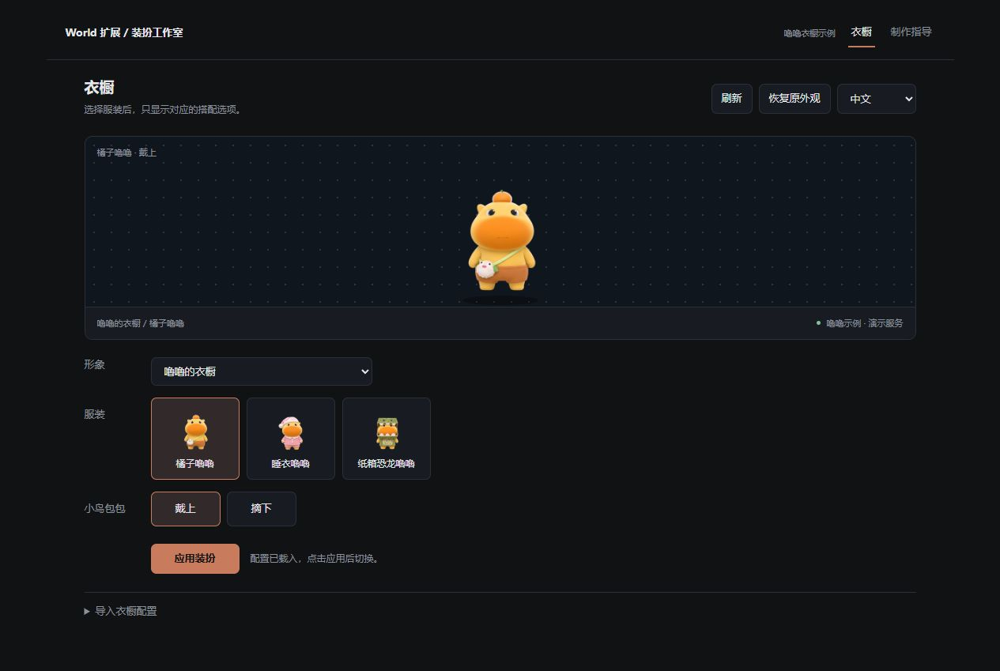

<div align="center">


# Wardrobe Studio

**Choose an outfit. Configure what belongs to it.**

Outfit-specific controls and a continuous-animation authoring guide for Coopanion.

[](https://www.npmjs.com/package/cortico-world-wardrobe-studio)
[](https://github.com/FelixHenrikChristian/coopanion-plugins/actions/workflows/check.yml)
[](LICENSE)

**English** · [简体中文](README_zh.md)

[Get started](#get-started) · [Create a character](docs/agent-workflow.md) · [Profile format](docs/profile-format.md) · [Downloads](https://github.com/FelixHenrikChristian/coopanion-plugins/releases)

</div>

---

## One outfit, its own controls

A character's outfits do not need to share every option. Wardrobe Studio groups existing complete figure schemes and displays only the controls that belong to the selected outfit.

| You want to… | Wardrobe Studio provides… |
| :--- | :--- |
| Organize a wardrobe | Outfit-specific options; unavailable combinations disabled |
| Choose a combination | Standard appearance persistence and local thumbnails |
| Create a character | Reference prompts, continuous video, playback gates and temporal matting guidance |
| Write an import profile | Field tables, Lulu examples, JSON Schema and installed-ID checks |

> [!IMPORTANT]
> **0.6.0 is independent-panel only.** Host-page patches have been removed. Stop the old version and verify rollback before upgrading; see the [migration guide](docs/panel-only-migration.md). Market reinstatement requires maintainer review.

<details>
<summary><strong>Separate-panel preview · Lulu wardrobe</strong></summary>
<br>
<div align="center"></div>

The Lulu example provides Orange with a removable bird bag, Pajamas and Cardboard Dinosaur: three outfits and four complete schemes. It reuses approved stills; the complete animated figure is supplied by the [independent Lulu release](https://github.com/FelixHenrikChristian/coopanion-plugins/releases/tag/lulu-v0.1.0).

</details>

## Get started

### 1 · Install and enable

Market reinstatement is pending review. For now, download a [GitHub release](https://github.com/FelixHenrikChristian/coopanion-plugins/releases), extract it and select the folder containing `package.json` in the manual installer.

### 2 · Prepare figure resources

Keep the desktop-pet World running and install/verify your figure pack first. The default service is `http://127.0.0.1:7797`; change it in the extension configuration if necessary, then restart this World.

**A wardrobe JSON groups existing resources; it contains no images or videos.** Every mapped combination must already be playable.

### 3 · Check and import

Open **Wardrobe Studio → Wardrobe → Import profile**. Inspect installed IDs, download the Lulu example or JSON Schema, fill in your figure/schemes, run **Check configuration**, then import. Choose an outfit/options and **Apply**.

The [default Lulu profile](examples/lulu.profile.json) matches the [independent Lulu figure release](https://github.com/FelixHenrikChristian/coopanion-plugins/releases/tag/lulu-v0.1.0). Install that figure pack and keep the sample IDs unchanged; replace IDs only when adapting it for another character.

The extension UI defaults to Chinese. Its **中文 / English** selector is persistent and independent of the host language; imported names remain your own text.

[Complete profile format and example →](docs/profile-format.md)

### 4 · Disable or uninstall

Use **Restore previous appearance**, disable the World, then uninstall. Version 0.6.0 does not write host program files or open a listening service. Normal stopping also restores an appearance still owned by the extension.

[Lifecycle and recovery](docs/lifecycle.md) · [Migration from old versions](docs/panel-only-migration.md)

## Create your own character

The guide panel, agent tool and downloadable manuals share the same source documents.

| Stage | Deliverable and acceptance |
| :--- | :--- |
| ① Plan | Identity, wardrobe/action matrix and reversible environment record |
| ② Reference | Fully dressed reference for each supported combination |
| ③ Continuous video | Dressed reference plus motion guidance; validate one short action first |
| ④ Raw-video review | Complete normal-speed, half-speed and loop playback |
| ⑤ Transparency | Connected white-background removal, protected light regions and full playback review |
| ⑥ Figure package | Coordinates, movement, transitions and actual expression coverage |
| ⑦ Wardrobe profile | Map installed complete schemes, validate and import |

[Read the detailed workflow →](docs/agent-workflow.md)

## Documentation

| Document | What it covers |
| :--- | :--- |
| [Authoring workflow](docs/agent-workflow.md) | Inputs, outputs, prompts, video/alpha requirements and figure interface |
| [White-background matting](docs/white-background-matting.md) | Topology-first recipe, optional offline helper, correction masks and flicker checks |
| [Profile format](docs/profile-format.md) | Required fields, limits, full example and missing combinations |
| [Troubleshooting](docs/troubleshooting.md) | Stale resource URLs, connections and runtime resources |
| [Verification](docs/verification.md) | Checks performed and compatibility boundaries |
| [Changelog](CHANGELOG.md) | Version history |

## Data and compatibility

- Profiles, language and recovery records stay in this extension's local namespace. No conversation reading or internet requests.
- Figure manifests, animation assets and host program files are never modified.
- The independent panel uses the documented desktop-pet appearance API.
- World API 6, figure manifest/API 2, Node.js ≥22; no runtime npm dependencies or model downloads.
- Guidance provides instructions, not automatic media generation or missing animation resources.

<details>
<summary><strong>Development and agent tools</strong></summary>

```sh
npm run check
npm test
npm run preview
```

The preview uses isolated temporary data and approved Lulu preview stills. Tests exercise recovery and origin restrictions against disposable fixtures.

| Tool | Purpose |
| :--- | :--- |
| `wardrobe_list` | Inspect local profiles and current appearance |
| `wardrobe_choose` | Apply an existing valid combination |
| `wardrobe_restore` | Restore a separately leased appearance |
| `wardrobe_authoring_guide` | Read workflow, format and troubleshooting guidance |

The bundled Lulu profile and four approved preview stills are authorized public examples. Keep personal figures, profiles and production records outside this repository.

</details>

---

<div align="center">

[MIT License](LICENSE) · Independent extension · Not an official Coopanion / Pal AI Lab component

MIT covers the plugin code. Lulu and its reference/preview artwork remain the property of their respective rights holders.

</div>
