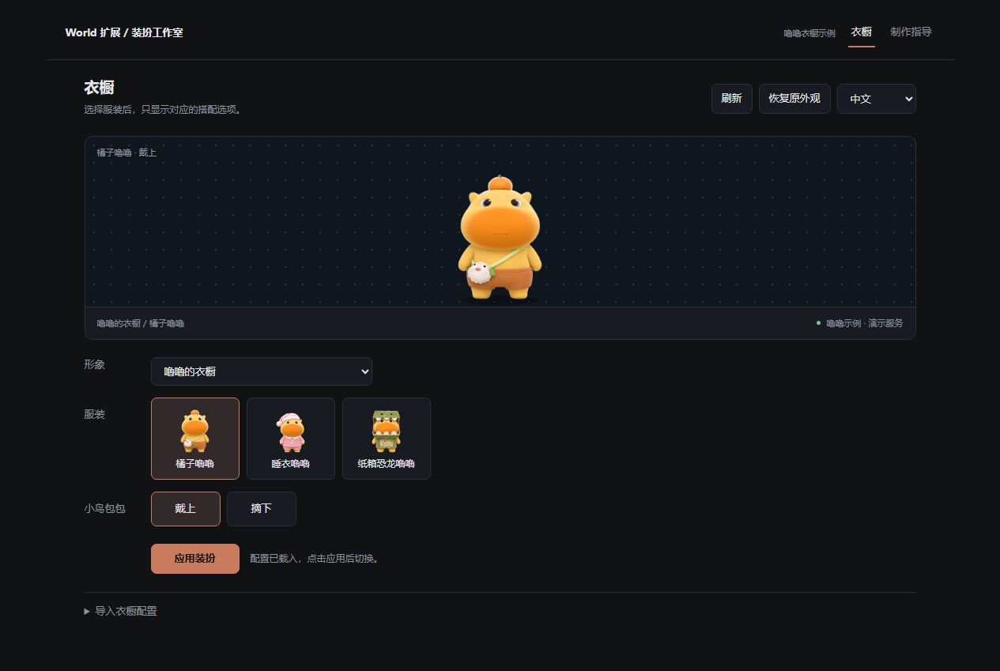
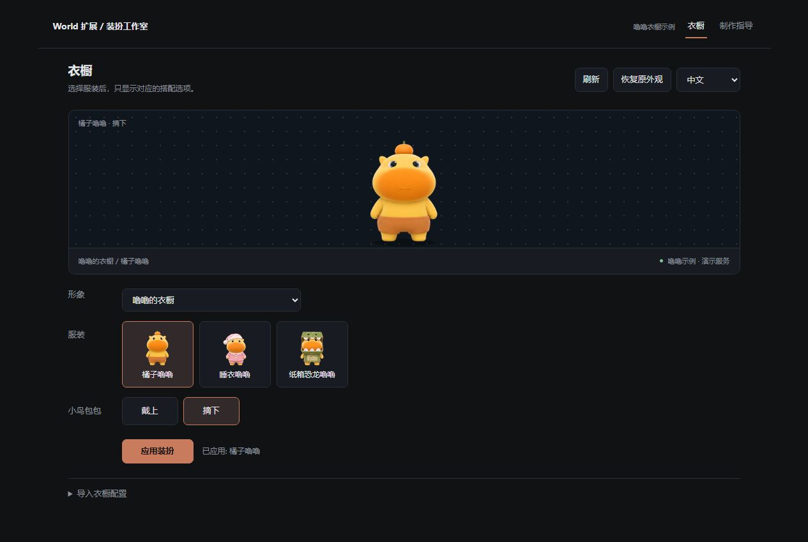

<div align="center">


# 装扮工作室

**独立衣橱，换衣服，也换配件。**

为 Coopanion 的形象提供独立衣橱：先选服装，再切换这套服装支持的包包等配件。另附从参考图、动作与表情生成、抠像到角色包接入的完整形象制作指导。

示例图中的水豚角色来自[噜噜插件](https://www.npmjs.com/package/cortico-world-lulu)。两个插件可分别使用；搭配噜噜及其角色包，就能在这里体验换装和摘戴小鸟包包。

[](https://www.npmjs.com/package/cortico-world-wardrobe-studio)
[](https://github.com/FelixHenrikChristian/coopanion-plugins/actions/workflows/check.yml)
[](LICENSE)

**简体中文** · [English](README.md)

[开始使用](#开始使用) · [制作自己的角色](docs/agent-workflow.zh.md) · [JSON 格式](docs/profile-format.zh.md) · [下载版本](https://github.com/FelixHenrikChristian/coopanion-plugins/releases)

</div>

---

## 给每个形象一间衣橱

先安装角色包并导入对应的衣橱配置，就能在同一个独立面板里选择形象、切换服装，再打开或关闭这套服装支持的配件。例如噜噜的橘子装可以戴上／摘下小鸟包包，睡衣和纸箱恐龙装则显示各自支持的搭配。

衣橱使用角色包中已经做好的完整外观，每个可选搭配都要有对应资源。想制作新形象或增加服装、配件，可以打开扩展内的“角色制作指导”，按完整流程准备参考图、生成动作与表情、抠像并接入角色包。

| 你要做的事 | 扩展提供什么 |
| :--- | :--- |
| 整理衣橱 | 按服装显示独立选项，禁用没有完整资源的组合 |
| 切换搭配 | 使用桌宠本机外观接口，读取本机角色缩略图 |
| 制作角色 | 参考图提示词、连续视频、播放验收、连续抠像、形象包接入指南 |
| 编写配置 | 完整字段表、噜噜示例、JSON Schema、本机 ID 查询和只读校验 |
| 切换语言 | 默认中文，可选 English，记住选择并保留编辑草稿 |

> [!IMPORTANT]
> **0.6.0 起仅提供独立面板，已删除原生页补丁。** 升级前先用旧版正常停用并确认还原；参见[迁移说明](docs/panel-only-migration.md)。[官方维护者已确认恢复收录](https://github.com/Pal-AI-Lab/cortico-extensions/issues/853#issuecomment-6832234773)。

## 噜噜衣橱实拍



这是插件实际面板在独立演示服务中的截图；角色来自[噜噜插件](https://www.npmjs.com/package/cortico-world-lulu)，使用其正式角色包的静帧，不含个人设置。先选橘子装，下方只显示对应的“小鸟包包”选项；选择睡衣或纸箱恐龙时，显示各自支持的搭配。



橘子装带包和摘包分别映射到 <code>bag</code>、<code>plain</code>，睡衣与恐龙装映射到 <code>sleep</code>、<code>dino</code>：**三套服装、四个完整外观**。点击“应用装扮”才会切换桌宠；图片是静态预览，不代表动画播放。完整动作由[独立噜噜角色包](https://github.com/FelixHenrikChristian/coopanion-plugins/releases/tag/lulu-v0.1.2)提供。


## 开始使用

### 1 · 安装并启用

已恢复官方市场收录。刷新 World 扩展市场，搜索“装扮工作室”或“Wardrobe Studio”；也可从 GitHub 下载，或在手动安装器填写 `cortico-world-wardrobe-studio@0.6.2`；按宿主提示重启 Core 后启用。

也可从 [GitHub Releases](https://github.com/FelixHenrikChristian/coopanion-plugins/releases) 下载归档，解压后在手动安装中选择含 `package.json` 的目录。

### 2 · 准备已有的角色资源

保持桌宠 World 运行，并先安装、验收自己的形象包。默认本机服务地址为 `http://127.0.0.1:7797`；端口不同可在扩展配置中修改，之后重启此 World。

**衣橱 JSON 负责分组，不包含图片或视频。** 每个有效搭配需要先有能实际播放的角色资源。

### 3 · 校验并导入衣橱

打开 **装扮工作室 → 衣橱 → 导入衣橱配置**：

1. 查看本机装扮 ID，下载噜噜示例或 JSON Schema。
2. 按自己的角色填写 `figure`、服装选项和已有 `scheme`。
3. 点击 **校验配置**，修复结构或 ID 报错后再导入。
4. 选择服装与搭配，点击 **应用装扮**。

[默认噜噜配置](examples/lulu.profile.json)对应[独立噜噜角色包](https://github.com/FelixHenrikChristian/coopanion-plugins/releases/tag/lulu-v0.1.2)。先安装该角色包即可直接使用示例 ID；仅在改成其他角色时替换 ID。

[完整 JSON 字段与可复制示例 →](docs/profile-format.zh.md)

### 4 · 停用或卸载

先点 **恢复原外观**，确认后停用 World，再卸载。0.6.0 不改写宿主程序文件，不开启本机监听服务；正常停用也会尝试恢复仍由扩展接管的外观。

[生命周期与恢复](docs/lifecycle.md) · [旧版迁移](docs/panel-only-migration.md)

## 制作自己的角色

手册与扩展内“角色制作指导”使用同一份内容，可以下载完整 Markdown 版。

| 阶段 | 交付与检查 |
| :--- | :--- |
| ① 规划 | 角色设定、服装／动作清单、环境与回退记录 |
| ② 参考图 | 每个有效搭配的完整穿衣图、统一轮廓与画风 |
| ③ 连续视频 | 完整穿衣参考 + 动作驱动，先验证一个短动作 |
| ④ 原片验收 | 完整原速、半速及循环接缝检查 |
| ⑤ 透明素材 | 连通白底去除、浅色前景保护、多背景完整播放检查 |
| ⑥ 形象包 | 坐标、移动、动作衔接及真实表情覆盖验收 |
| ⑦ 衣橱配置 | 映射已安装搭配，校验后导入 |

[阅读详细制作指南 →](docs/agent-workflow.zh.md)

## 文档导航

| 文档 | 内容 |
| :--- | :--- |
| [从零制作](docs/agent-workflow.zh.md) | 输入输出、提示词、视频与透明素材要求、形象接口骨架 |
| [白底抠像](docs/white-background-matting.zh.md) | 连通关系优先、可选离线工具、修正蒙版与闪烁检查 |
| [衣橱 JSON](docs/profile-format.zh.md) | 必填字段、ID 规则、完整示例、缺失组合和常见报错 |
| [故障排查](docs/troubleshooting.zh.md) | 旧资源地址、连接与预览、配置通过但动画缺失 |
| [验证范围](docs/verification.md) | 实际检查过什么、兼容性边界 |
| [更新记录](CHANGELOG.md) | 已发布版本变更 |

## 数据与兼容

- **本机存储**：配置、语言偏好和外观恢复记录保存在扩展自己的目录。
- **资源保护**：角色 manifest、动画素材和宿主程序文件均不改写。
- **恢复边界**：强制结束进程、服务不可用或旧角色被删除时，可能需要下次启用后恢复；卸载前应确认结果。
- **接口边界**：换装使用桌宠内部的 `GET /api/figures`、`GET /api/state`、`POST /api/skin`，并非公开兼容契约，宿主更新后可能需要适配。
- **运行要求**：World API 6、形象包 manifest/API 2、Node.js ≥22，零运行时 npm 依赖。
- **能力范围**：指导工具提供步骤，不自动安装模型、生成素材或补齐未制作的动作。Coo 自带配件继续使用原生页。

<details>
<summary><strong>开发与 agent 工具</strong></summary>

```sh
npm test
npm run check
npm run preview
```

开发预览使用独立临时数据与已确认的噜噜预览。

| 工具 | 作用 |
| :--- | :--- |
| `wardrobe_list` | 读取本地衣橱和当前外观 |
| `wardrobe_choose` | 切换已有合法搭配 |
| `wardrobe_restore` | 恢复扩展接管前外观 |
| `wardrobe_authoring_guide` | 读取制作流程、格式与排查说明 |

公共源码使用已明确授权公开的噜噜示例。个人角色、衣橱配置和生产记录应放在仓库之外。

</details>

---

<div align="center">

[MIT License](LICENSE) · 第三方独立扩展 · 非 Coopanion / Pal AI Lab 官方组件

MIT 适用于插件代码；噜噜角色及其参考／预览图的权利归各自权利人。

</div>
