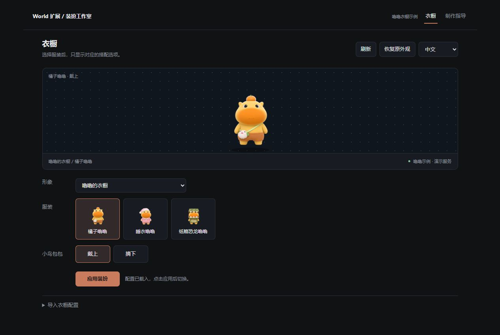

<div align="center">


# 装扮工作室

**先选服装，再选搭配。**

为 Coopanion 整理角色衣橱，提供从参考图到连续动画的制作指南。

[](https://www.npmjs.com/package/cortico-world-wardrobe-studio)
[](https://github.com/FelixHenrikChristian/cortico-world-wardrobe-studio/actions/workflows/check.yml)
[](LICENSE)

**简体中文** · [English](README.md)

[开始使用](#开始使用) · [制作自己的角色](docs/agent-workflow.zh.md) · [JSON 格式](docs/profile-format.zh.md) · [下载版本](https://github.com/FelixHenrikChristian/cortico-world-wardrobe-studio/releases)

</div>

---

## 一套服装，一组自己的选项

同一角色的不同服装不必共用所有配置项。装扮工作室把角色包已有的完整外观重新分组，只显示当前服装支持的搭配。

| 你要做的事 | 扩展提供什么 |
| :--- | :--- |
| 整理衣橱 | 按服装显示独立选项，禁用没有完整资源的组合 |
| 切换搭配 | 使用桌宠标准外观接口，读取本机角色缩略图 |
| 制作角色 | 参考图提示词、连续视频、播放验收、连续抠像、形象包接入指南 |
| 编写配置 | 完整字段表、虚构示例、JSON Schema、本机 ID 查询和只读校验 |
| 切换语言 | 默认中文，可选 English，记住选择并保留编辑草稿 |

> [!IMPORTANT]
> **0.4 新增可选的原生装扮页兼容补丁，默认关闭。** 这不是官方 World 插槽，会临时修改经过校验的原生页面，正常停用时恢复。不兼容版本会拒绝修改。[支持版本、设置和回滚说明 →](docs/native-integration.zh.md)

<details>
<summary><strong>查看独立衣橱预览 · 完全虚构角色</strong></summary>
<br>
<div align="center"></div>

示例“苔星狐”的探险装有斗篷和足部装备，雨林装有雨帽与雨披颜色，观星装只有护目镜。公开素材仅包含虚构示例。

</details>

## 开始使用

### 1 · 安装并启用

在 Coopanion 的 **World 扩展市场**搜索 `装扮工作室` 或 `cortico-world-wardrobe-studio`，安装后按宿主提示重启 Core，再启用扩展。

也可从 [GitHub Releases](https://github.com/FelixHenrikChristian/cortico-world-wardrobe-studio/releases) 下载归档，解压后在手动安装中选择含 `package.json` 的目录。

### 2 · 准备已有的角色资源

保持桌宠 World 运行，并先安装、验收自己的形象包。默认本机服务地址为 `http://127.0.0.1:7797`；端口不同可在扩展配置中修改，之后重启此 World。

**衣橱 JSON 负责分组，不包含图片或视频。** 每个有效搭配需要先有能实际播放的角色资源。

### 3 · 校验并导入衣橱

打开 **装扮工作室 → 衣橱 → 导入衣橱配置**：

1. 查看本机装扮 ID，下载虚构示例或 JSON Schema。
2. 按自己的角色填写 `figure`、服装选项和已有 `scheme`。
3. 点击 **校验配置**，修复结构或 ID 报错后再导入。
4. 选择服装与搭配，点击 **应用装扮**。

[完整 JSON 字段与可复制示例 →](docs/profile-format.zh.md)

### 4 · 可选：在原生装扮页选择

导入配置后，在扩展配置填写已安装 desktop-pet 包的 `web` 绝对目录，开启「原生装扮页兼容补丁」，重启此 World 并重新打开原生装扮页。配置过的角色显示「服装 → 当前服装的部件」；其他角色与 Coo 保持原控件。启用前请阅读[兼容与回滚说明](docs/native-integration.zh.md)。

### 5 · 停用或卸载

独立面板应用的外观先点 **恢复原外观**并确认成功，再停用 World，确认原生页兼容补丁已恢复后卸载。正常停用也会尝试恢复仍由扩展接管的外观；原生页选择按普通宿主装扮保存，停用后保留。

[生命周期、异常恢复与边界 →](docs/lifecycle.md)

## 制作自己的角色

手册与扩展内“角色制作指导”使用同一份内容，可以下载完整 Markdown 版。

| 阶段 | 交付与检查 |
| :--- | :--- |
| ① 规划 | 角色设定、服装／动作清单、环境与回退记录 |
| ② 参考图 | 每个有效搭配的完整穿衣图、统一轮廓与画风 |
| ③ 连续视频 | 完整穿衣参考 + 动作驱动，先验证一个短动作 |
| ④ 原片验收 | 完整原速、半速及循环接缝检查 |
| ⑤ 透明素材 | 连通白底去除、浅色前景保护、多背景完整播放检查 |
| ⑥ 形象包 | 坐标、移动、动作衔接及真实表情覆盖验收 |
| ⑦ 衣橱配置 | 映射已安装搭配，校验后导入 |

[阅读详细制作指南 →](docs/agent-workflow.zh.md)

## 文档导航

| 文档 | 内容 |
| :--- | :--- |
| [从零制作](docs/agent-workflow.zh.md) | 输入输出、提示词、视频与透明素材要求、形象接口骨架 |
| [白底抠像](docs/white-background-matting.zh.md) | 连通关系优先、可选离线工具、修正蒙版与闪烁检查 |
| [衣橱 JSON](docs/profile-format.zh.md) | 必填字段、ID 规则、完整示例、缺失组合和常见报错 |
| [故障排查](docs/troubleshooting.zh.md) | 旧资源地址、连接与预览、配置通过但动画缺失 |
| [原生页兼容](docs/native-integration.zh.md) | 实验集成、精确版本限制、文件变更与卸载恢复 |
| [验证范围](docs/verification.md) | 实际检查过什么、兼容性边界 |
| [更新记录](CHANGELOG.md) | 已发布版本变更 |

## 数据与兼容

- **本机存储**：配置、语言偏好和外观恢复记录保存在扩展自己的目录。
- **资源保护**：角色 manifest 与动画素材始终不改写；原生页兼容选项开启后临时修改其文档列出的页面文件。
- **恢复边界**：强制结束进程、服务不可用或旧角色被删除时，可能需要下次启用后恢复；卸载前应确认结果。
- **运行要求**：World API 6、形象包 manifest/API 2、Node.js ≥22，零运行时 npm 依赖。
- **能力范围**：指导工具提供步骤，不自动安装模型、生成素材或补齐未制作的动作。Coo 自带配件继续使用原生页。

<details>
<summary><strong>开发与 agent 工具</strong></summary>

```sh
npm test
npm run check
npm run preview
```

开发预览使用独立临时数据与虚构角色。原生集成原型是另一个隔离服务，启动方式见其文档。

| 工具 | 作用 |
| :--- | :--- |
| `wardrobe_list` | 读取本地衣橱和当前外观 |
| `wardrobe_choose` | 切换已有合法搭配 |
| `wardrobe_restore` | 恢复扩展接管前外观 |
| `wardrobe_authoring_guide` | 读取制作流程、格式与排查说明 |

公共源码只使用完全虚构的示例。个人角色、衣橱配置和生产记录应放在仓库之外。

</details>

---

<div align="center">

[MIT License](LICENSE) · 第三方独立扩展 · 非 Coopanion / Pal AI Lab 官方组件

</div>
