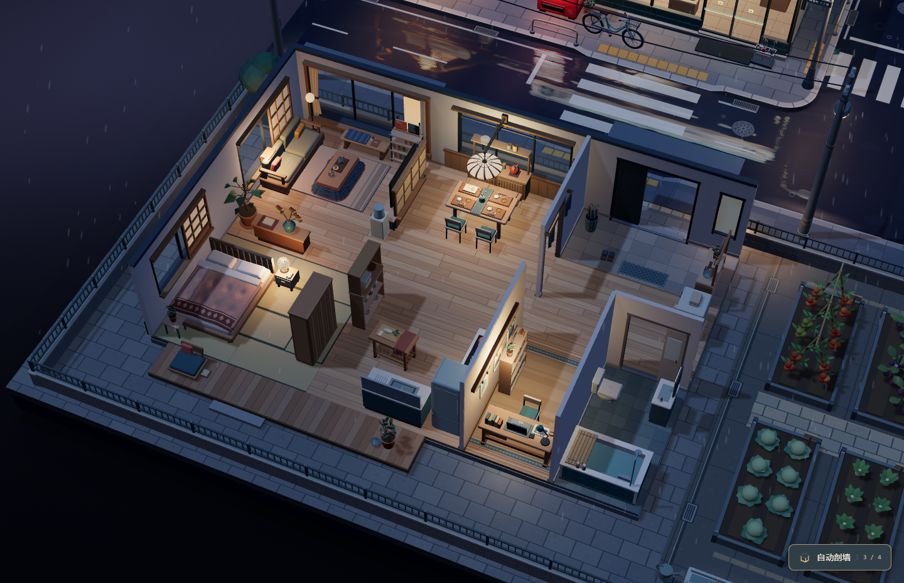

# 雨音マート · 灯影横丁


细雨中，雨音マート的青绿色招牌和茶房「灯乃庭」的琥珀色街灯映在路上。两家店之间是「灯影横丁」，沿巷口的町内掲示板往里看，可以看见通往后院的石板路。

打开模型，街面、货架、木梁、瓦片和架空电线会分层组装。拉近便利店橱窗可以看清饮料和杂志，转向茶房的木格窗能看见铁壶、茶杯和和菓子。

从雨音マート经过斑马线就是雨庭公寓。临街窗下的坐榻旁摆着花器，西墙边的木扶手沙发朝向被炉和影音柜，柜子的另一侧是餐桌与茶器柜。卧室铺有八张实体榻榻米，隔壁书房从门槛到障子窗下都铺着裂织地毯，木桌上还晾着一张双色版画。屋檐下是避雨的木廊，屋顶木架下是亮着和纸灯的双人茶席。

街边的电线从茶房接过窄街，两盏防犯灯照着住宅这侧的人行道。绣球花旁的小门通往共同菜园，八块菜畦可分别选取。街对面的「余白レコード」在酒红雨棚下展示黑胶唱片，二楼是有唱机和扶手椅的听音室。洗衣店的等候席靠着前窗，左墙的机器朝向店内。沿店旁的小巷能看到后方公寓各户的推拉门、窗帘和阳台。



点击右下角按钮，依次切换 **完整外观 → 全部墙面 → 自动剖墙 → 无墙俯览**。从街景点一次即可收起屋顶，环绕查看全部外墙和隔墙。再点一次进入上图的自动剖墙视图，挡住房间的墙段会随视角隐藏。

目前有 **32 个住宅家具点击点、7 个商铺点击点和 8 块菜畦**，提供稳定标识、点击事件和角色接近位置。便利店与茶房沿现有斑马线接入导航；自动剖墙会跟随当前进入或选中的建筑，切换墙面不会移动镜头。独立 HTML 负责场景接口，购物结算、角色动作与种植进度由家园插件接入。[完整交互清单与桌宠接入说明](docs/desk-pet.md)

## 打开模型

在仓库中点开 [amane-mart.html](amane-mart.html)，点击文件右上方的下载按钮（Download raw file）。用浏览器打开下载的 HTML，即可离线观看。刷新页面可重播组装动画。

| 设备 | 操作 |
| --- | --- |
| 鼠标 | 左键拖拽旋转，滚轮缩放，右键拖拽平移。 |
| 触屏 | 单指拖拽旋转，双指捏合缩放，双指同向拖动平移。 |
| 键盘 | 先点一下画面，使用方向键旋转、加减键缩放，按 Home 返回初始视角。 |

## 从源码构建

场景源码位于 [src/](src/)。在本场景目录 `scenes/amane-mart` 依次运行以下命令，即可重新生成 `amane-mart.html`。

嵌入 World 页面时使用同一场景的实例化接口，生命周期与角色遮挡协议见 [嵌入说明](docs/embedding.md)。

```sh
npm ci
npm run build
```
